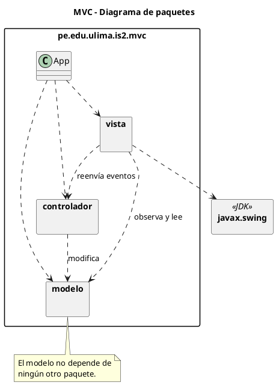
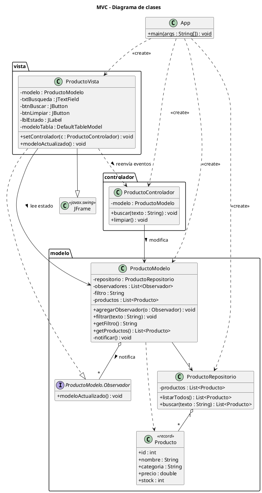
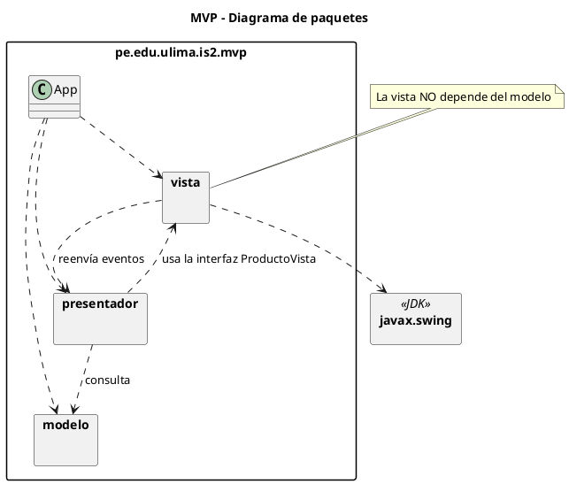
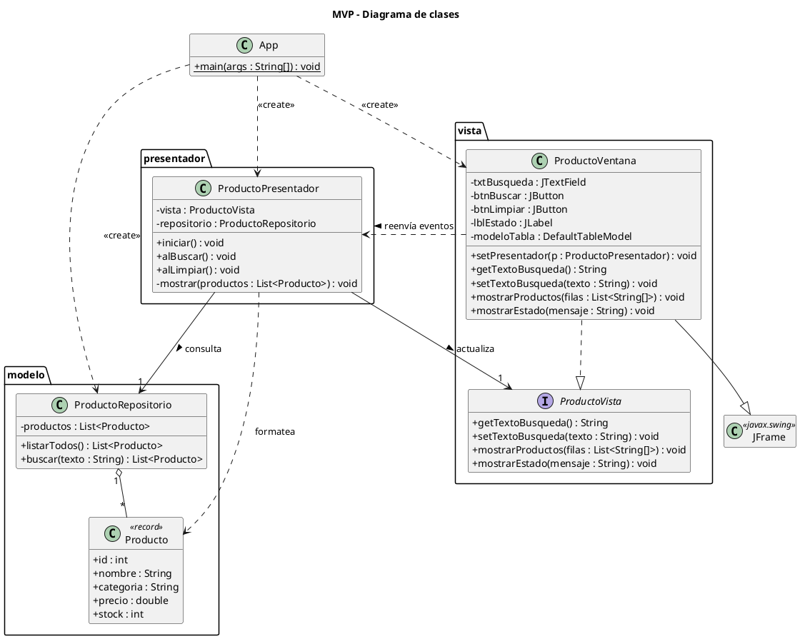
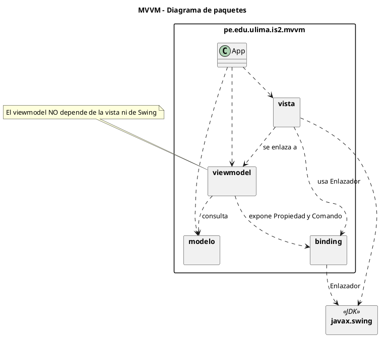
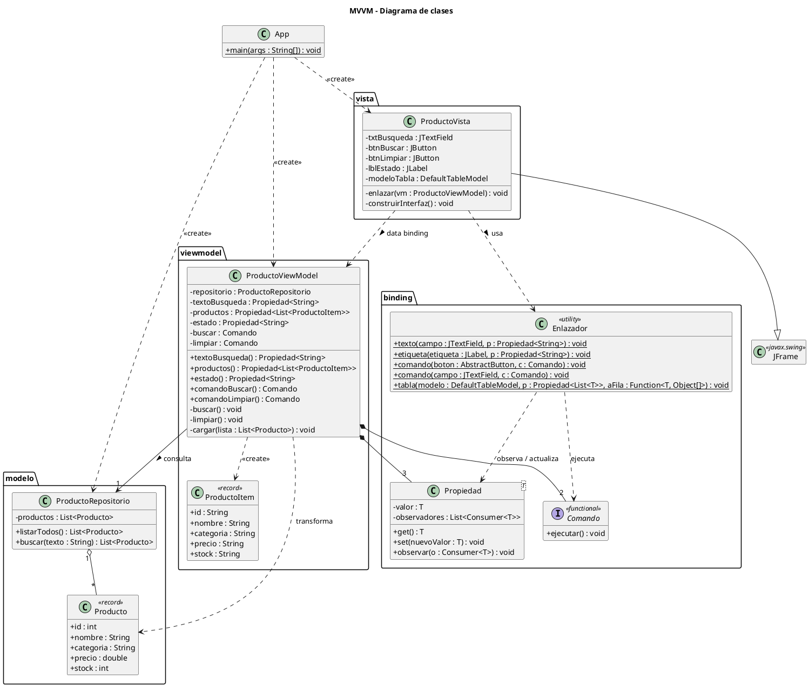
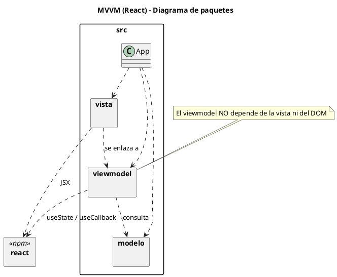
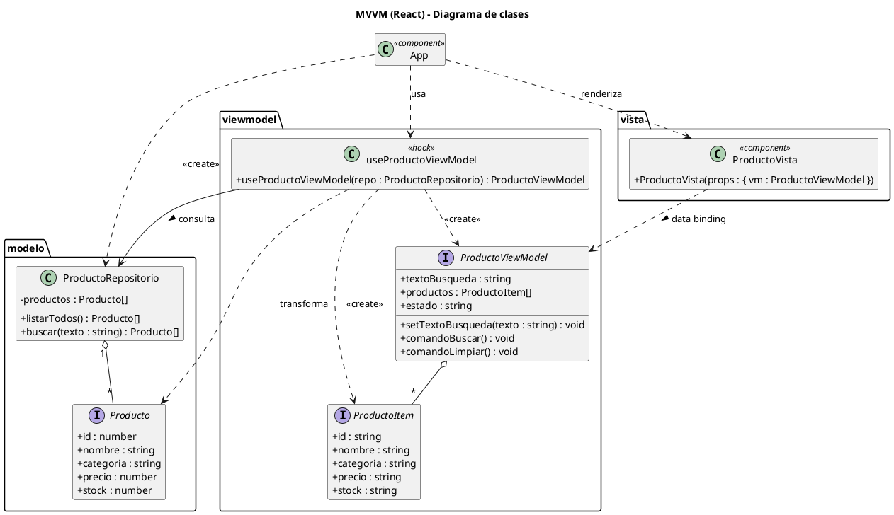
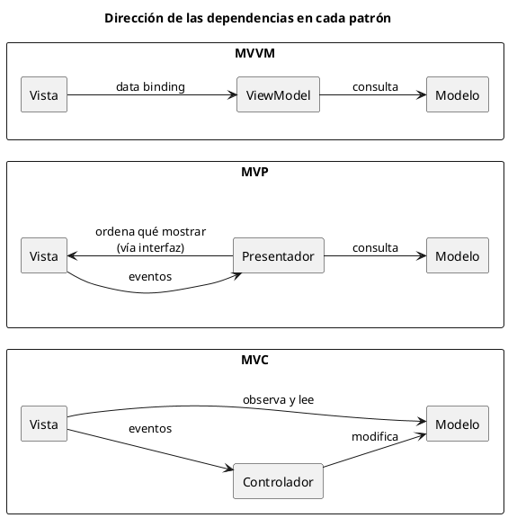

# Documentación: MVC, MVP y MVVM

Este documento describe la arquitectura de los proyectos de ejemplo
(`productos-mvc`, `productos-mvp`, `productos-mvvm` y `productos-mvvm-react`).
Para cada uno se incluye:

- Un **diagrama de paquetes**, que muestra qué capa depende de cuál.
- Un **diagrama de clases**, que muestra las clases, sus miembros principales y
  sus relaciones.

Los diagramas están escritos en [PlantUML](https://plantuml.com). Para verlos
puedes usar la extensión de PlantUML de VS Code o IntelliJ, o pegarlos en
<https://www.plantuml.com/plantuml>.

Las clases del dominio, `Producto` y `ProductoRepositorio`, son iguales en las
tres aplicaciones. Lo único que cambia es la organización de la capa de
presentación.

---

## 1. MVC: Model-View-Controller

### 1.1 Diagrama de paquetes

### 1.2 Diagrama de clases

**Puntos clave**

- `ProductoVista` implementa `Observador`. Cuando el modelo cambia, la vista
  **lee los datos directamente** de `ProductoModelo` y da formato a los precios.
- `ProductoControlador` solo modifica el modelo. **No tiene ninguna referencia a
  la vista.**
- `ProductoModelo` conoce a sus observadores solo a través de la interfaz
  `Observador`, así que no depende del paquete `vista`.

---

## 2. MVP: Model-View-Presenter

### 2.1 Diagrama de paquetes

### 2.2 Diagrama de clases

**Puntos clave**

- `ProductoPresentador` depende de la **interfaz** `ProductoVista`, no de Swing.
  Por eso se puede probar con una vista falsa o cambiar la interfaz gráfica sin
  tocarlo.
- `ProductoVentana` es una vista pasiva: no importa nada del paquete `modelo` y
  recibe las filas ya formateadas como `List<String[]>`.
- El presentador **le indica a la vista** qué mostrar, llamando a
  `mostrarProductos` y `mostrarEstado`.

---

## 3. MVVM: Model-View-ViewModel

### 3.1 Diagrama de paquetes

### 3.2 Diagrama de clases

**Puntos clave**

- `ProductoViewModel` expone su **estado** como `Propiedad<T>` y sus **acciones**
  como `Comando`. No tiene ninguna referencia a la vista y no importa Swing.
- `ProductoVista` no tiene métodos del tipo `mostrarXxx()`. Solo conecta sus
  componentes al ViewModel en `enlazar()`, usando `Enlazador`.
- La flecha va **solo de la vista hacia el ViewModel**. En MVP, en cambio, el
  presentador también apunta a la vista a través de su interfaz.
- El paquete `binding` reemplaza lo que en JavaFX, WPF o Android ofrece la propia
  plataforma.

---

## 4. MVVM en React + TypeScript

El proyecto `productos-mvvm-react` implementa el mismo caso como aplicación web.
React ya trae data binding (estado + re-render), así que no hace falta un
paquete `binding`: el ViewModel es un *custom hook*.

| Java / Swing (`productos-mvvm`) | React (`productos-mvvm-react`) |
|---------------------------------|--------------------------------|
| `Propiedad<T>`                  | `useState`                     |
| `Comando`                       | función expuesta por el hook   |
| `Enlazador`                     | re-render de React + `value`/`onChange`/`onClick` |
| `ProductoViewModel` (clase)     | `useProductoViewModel` (hook)  |
| `ProductoVista` (`JFrame`)      | `ProductoVista` (componente)   |

### 4.1 Diagrama de paquetes

### 4.2 Diagrama de clases

**Puntos clave**

- `useProductoViewModel` no contiene JSX ni toca el DOM. Expone estado
  (`textoBusqueda`, `productos`, `estado`) y comandos (`comandoBuscar`,
  `comandoLimpiar`), igual que la versión Swing.
- `ProductoVista` recibe el ViewModel por props y **no importa nada de
  `modelo`**: pinta `ProductoItem` con los precios ya formateados.
- El `<input>` tiene enlace **bidireccional** (`value` + `onChange`): al pulsar
  *Limpiar*, el ViewModel pone `textoBusqueda` en `''` y el campo se vacía solo.

---

## 5. Comparación de dependencias

| Pregunta                                | MVC   | MVP                   | MVVM         |
|-----------------------------------------|-------|-----------------------|--------------|
| ¿La vista conoce al modelo?             | Sí    | No                    | No           |
| ¿El intermediario conoce a la vista?    | No    | Sí, vía interfaz      | No           |
| ¿Quién da formato a los datos?          | Vista | Presentador           | ViewModel    |
| ¿Cómo se actualiza la vista?            | Observer sobre el modelo | El presentador llama a sus métodos | Data binding |
